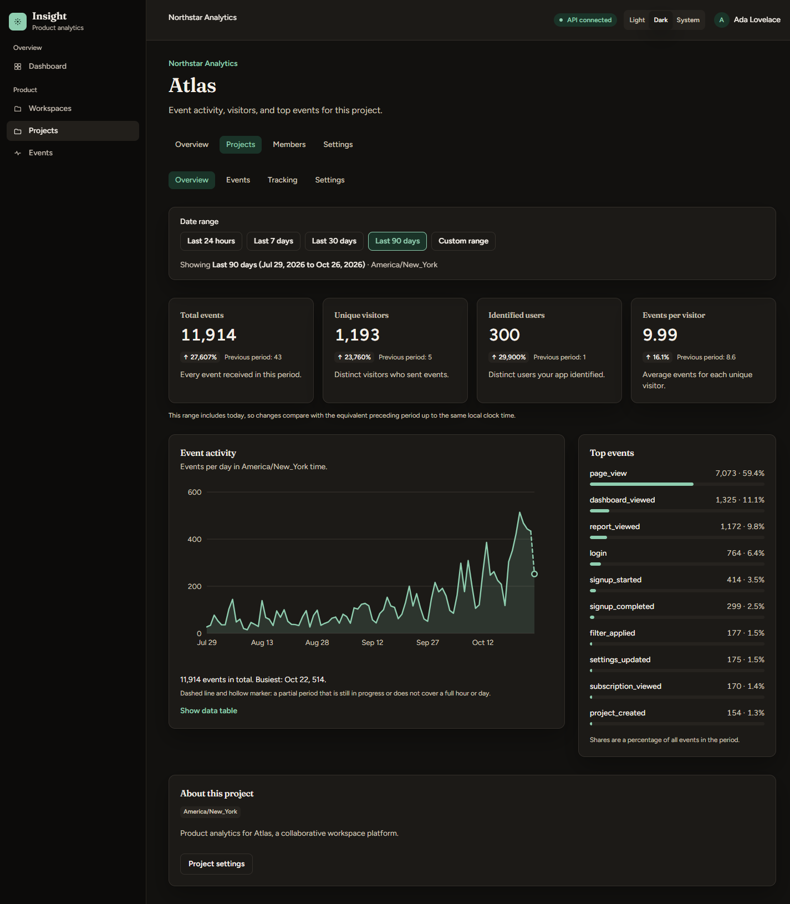
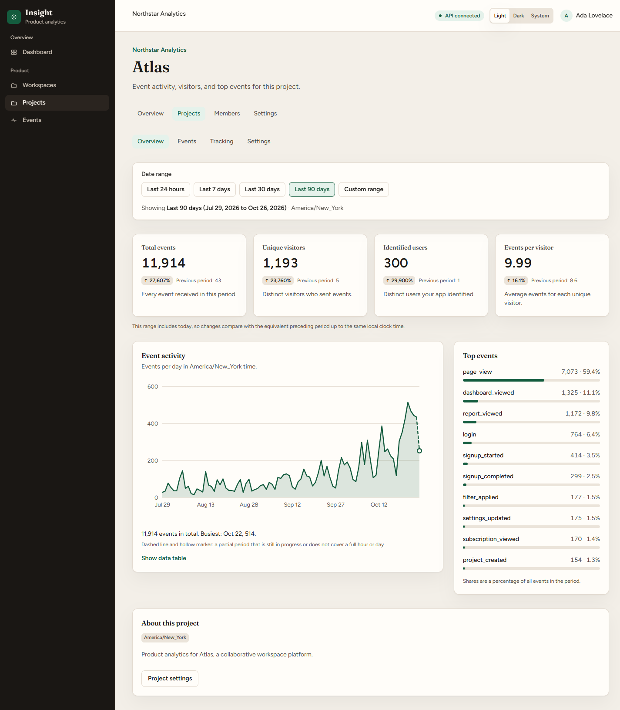
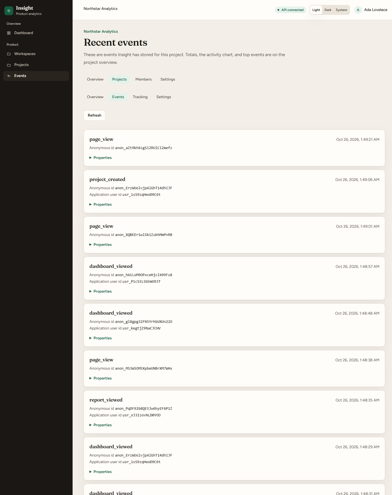
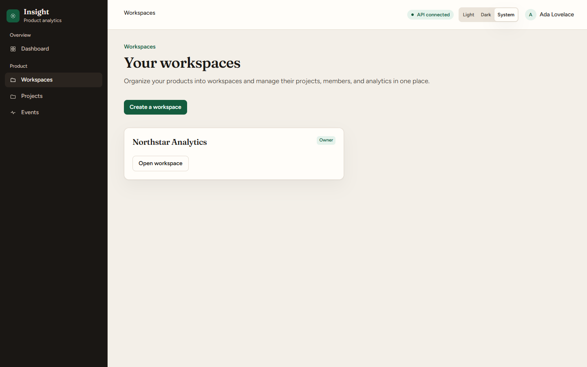
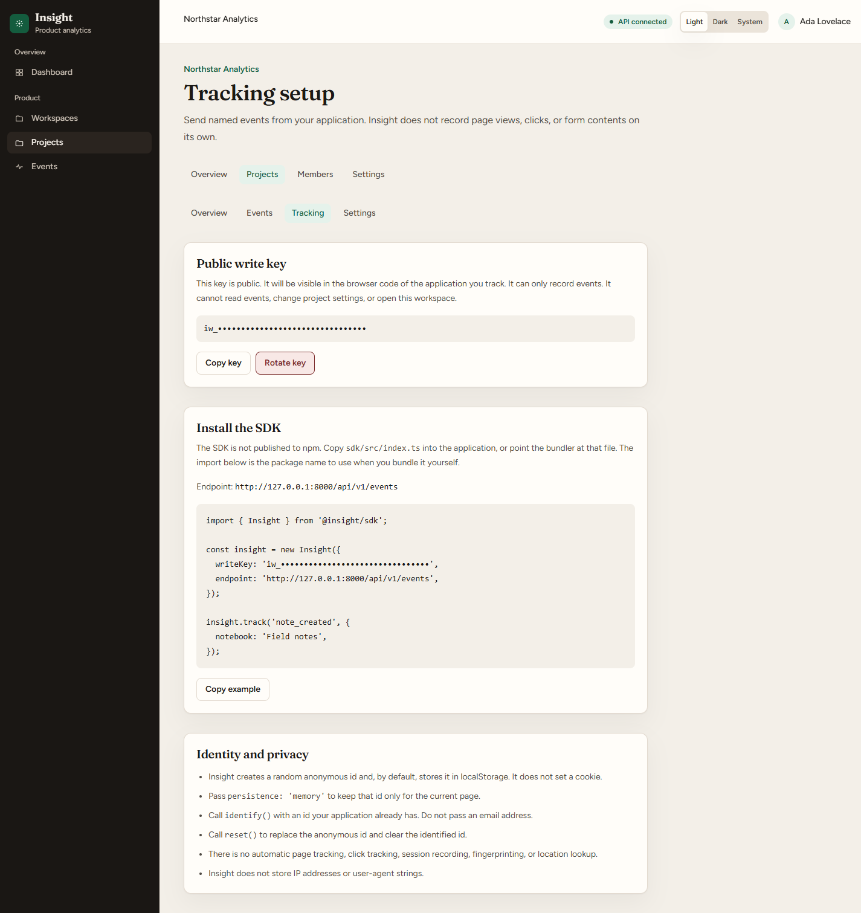
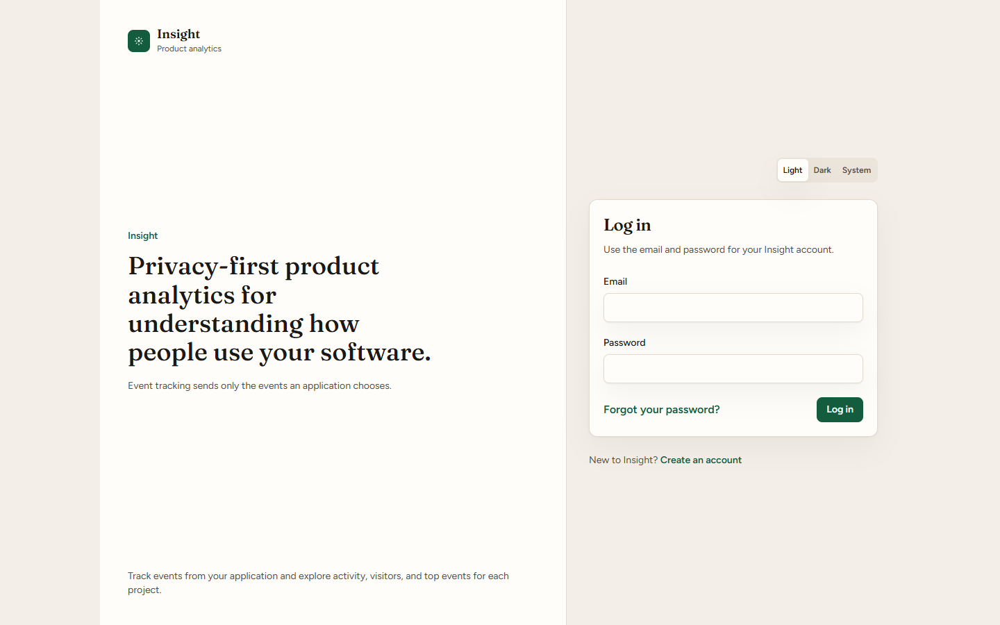

# Insight

**Privacy-first product analytics for understanding how people use your software.**

Insight collects the events an application explicitly chooses to send, such as `report_exported`, and turns them into project-level analytics: totals, unique visitors, identified users, activity over time, and top events. Teams organize their work in workspaces, and each workspace holds projects with their own write key, timezone, and event history.

This is a portfolio application. It is a complete working codebase with automated tests, but it is not a hosted analytics service and has not been run in production.

## Screenshots

All analytics shown below use **synthetic showcase data**. The workspace, project, user, visitors, and events are fictional and were generated locally with `php artisan insight:seed-demo` (see [Local showcase dataset](#local-showcase-dataset)). None of it is real customer analytics.

### Analytics dashboard - Dark mode

Project overview for the fictional "Atlas" project over the last 90 days: key metrics with previous-period comparison, an activity chart, and top events.



### Analytics dashboard - Light mode

The same view in the light theme. Light, dark, and system themes are supported.



### Recent events

Every stored event for a project, with its anonymous id, optional application user id, and properties.



### Workspaces

Workspaces group projects and carry roles for their members.



### Tracking setup

Setup instructions and a copyable SDK example. The public write key has been masked in this image.



### Sign in



## Implemented features

Everything below exists in the code and is covered by automated tests.

**Authentication**

- Account registration and sign-in with Laravel session authentication
- Password reset by emailed link (messages go to the log in local development)
- Login attempts are limited to five per email and IP address, and password-reset requests to five per minute per IP address
- Session regeneration on sign-in, registration, and password reset; sign-out is a `POST`

**Workspaces and projects**

- Workspaces with owner, admin, and member roles; creating a workspace makes you its owner
- A members page that lists each member and role (it is read-only: there is no invitation flow yet)
- Owners and admins can rename a workspace and create, edit, archive, and restore projects; members have read access
- Project authorization is checked on the server (`WorkspacePolicy`, `ProjectPolicy`, and a tenant check that returns 404 for resources outside your workspaces)
- A configurable IANA timezone for every project
- Archived projects reject new events until restored

**Event tracking**

- `POST /api/v1/events` ingestion with strict validation
- A JavaScript tracking SDK in `sdk/src/index.ts`
- Anonymous visitors and optionally identified application users
- Custom event properties (JSON object, size and depth limited)
- Client event IDs with per-project deduplication
- Public, project-scoped write keys that can be rotated by owners and admins
- Collection is explicit: an event exists only when application code calls `track()`

**Analytics**

- Total events, unique visitors, identified users, and events per visitor
- Activity over time, hourly for 24-hour ranges and daily otherwise, with partial periods marked
- Top events with counts and share of all events
- Date ranges: last 24 hours, 7, 30, and 90 days, and custom ranges up to 90 days
- Previous-period comparison for each metric
- Calendar boundaries calculated in the project timezone, including daylight saving transitions
- A recent event list per project
- An accessible chart with a visible data-table toggle

## Technology stack

| Area                  | Technology                                                     |
| --------------------- | -------------------------------------------------------------- |
| Backend               | Laravel 12, PHP 8.2 or newer                                   |
| Frontend              | React 19, TypeScript 6                                         |
| Application bridge    | Inertia.js 3                                                   |
| Styling               | Tailwind CSS v4, Fraunces and Figtree fonts                    |
| Database              | MariaDB 10.11 (`mysql` driver); SQLite in memory for PHP tests |
| Build tooling         | Vite 8                                                         |
| Backend testing       | Pest 3                                                         |
| Frontend testing      | Vitest 5 with React Testing Library                            |
| Code quality          | Laravel Pint, ESLint, Prettier                                 |
| Screenshot automation | Playwright (optional, local only)                              |

Docker, Redis, PostgreSQL, and WSL are not required. Cache, sessions, and queues use Laravel's database drivers.

## Architecture

- **Laravel with Inertia.** Laravel owns routing, authentication, validation, and authorization. Controllers return Inertia responses and a single React and TypeScript frontend renders them, so there is no separate API for the pages.
- **Workspace and project tenancy.** A user belongs to workspaces through memberships with a role. Projects belong to a workspace and events belong to a project. Every web route is scoped by workspace and project, and the project must belong to the workspace in the URL.
- **Server-side authorization.** Policies and a tenant check run on the server for each request. The React interface hides actions a user cannot take, but it is not relied on for security.
- **Event ingestion.** `POST /api/v1/events` lives outside the session and CSRF middleware. A middleware applies CORS and a per-key rate limit, a form request validates the payload, and the project is found by write key.
- **Append-only events.** `AnalyticsEvent` rejects updates and deletes at the model level, and ingestion only inserts. Both `occurred_at` and `received_at` are stored in UTC.
- **Project-scoped aggregates.** `ProjectAnalytics` computes every metric from one project's events only. The overview page receives the result as a single `analytics` prop, and date-range changes reload only that prop.
- **Timezone-aware ranges.** `DateRangeResolver` turns a preset or custom dates into half-open UTC windows from the project's timezone, so daylight saving days of 23 or 25 hours are handled and the previous period is built from the same calendar rules.
- **Separate SDK.** The SDK is plain TypeScript with no framework dependency and talks to the public HTTP endpoint only.

See [`docs/architecture.md`](docs/architecture.md) for the directory layout, the Inertia integration, and more detail.

## Privacy and security

These are design decisions and implemented controls. They are not certifications or guarantees.

- Insight records only events that application code sends. It does no session recording, no automatic click or form tracking, no fingerprinting, and does not read page contents.
- The `analytics_events` table has no columns for IP addresses or user-agent strings, and ingestion stores neither. The client IP is used only, together with the write key, as a hashed rate-limit key. Web server and framework logs are outside the event store and depend on how you run the app.
- The SDK stores an anonymous id in `localStorage` and sets no cookie. It can keep the id in memory only with `persistence: 'memory'`.
- Event properties are free-form, so an application must not send personal data in them. Pass an application-internal id to `identify()`, not an email address.
- Analytics data is scoped to a project, and web access is scoped to workspace members.
- Write keys are public by design. They can only record events, and they cannot read events or change settings.
- Ingestion validates names, identifiers, timestamps, and properties, limits the request body to 16 KB, and rate-limits by write key and client IP.
- Insight has not been audited, penetration tested, or certified (for example GDPR or SOC 2). Treat it as a well-tested reference implementation, not a production-hardened service.

## Local development

These steps use PowerShell. On macOS or Linux, use `cp` instead of `Copy-Item`. You need PHP 8.2 or newer, Composer, Node.js with npm, and a running MariaDB server (10.11 is what the project is developed against).

1. Clone the repository and enter it.

   ```powershell
   git clone https://github.com/devtdlv/insight.git
   cd insight
   ```

2. Install PHP and JavaScript dependencies.

   ```powershell
   composer install
   npm install
   ```

3. Create your environment file and application key.

   ```powershell
   Copy-Item .env.example .env
   php artisan key:generate
   ```

4. Create an empty MariaDB database and a user for it, for example:

   ```sql
   CREATE DATABASE insight CHARACTER SET utf8mb4;
   CREATE USER 'insight'@'127.0.0.1' IDENTIFIED BY 'choose-a-local-password';
   GRANT ALL PRIVILEGES ON insight.* TO 'insight'@'127.0.0.1';
   ```

5. Set `DB_DATABASE`, `DB_USERNAME`, and `DB_PASSWORD` in `.env`. Never commit `.env`.

6. Create the tables.

   ```powershell
   php artisan migrate
   ```

7. Start Laravel and Vite in two terminals and keep both running.

   ```powershell
   php artisan serve
   ```

   ```powershell
   npm run dev
   ```

8. Open `http://127.0.0.1:8000`, register an account, and create a workspace and a project.

Run `php artisan queue:work` in a third terminal only if you add queued jobs. Password reset emails are written to the log because `MAIL_MAILER=log`.

## JavaScript SDK

The SDK is `sdk/src/index.ts`. It is not published to npm, so there is no package to install. Copy the file into an application or point your bundler at it. The import path below is illustrative.

```ts
import { Insight } from './insight-sdk';

const insight = new Insight({
  writeKey: 'iw_<your-project-write-key>',
  endpoint: 'http://127.0.0.1:8000/api/v1/events',
});

insight.identify('user_1042');

insight.track('report_exported', {
  format: 'csv',
  rows: 128,
});
```

`track()` sends one event with a generated event id and a timestamp. It resolves with `{ ok: true, status }` or `{ ok: false, error }`, and it never throws on a network failure. `identify(userId)` stores an application user id, `reset()` replaces the anonymous id and clears the user id, and `debug: true` prints failures in the console. Each project's Tracking page shows its own key and a copyable example.

## Event ingestion reference

`POST /api/v1/events` accepts one JSON object. The project is the row whose `write_key` matches. A `project_id` in the body is ignored.

```json
{
  "write_key": "iw_0123456789abcdef0123456789abcdef",
  "name": "report_exported",
  "anonymous_id": "anon_reader001",
  "user_id": "user_1042",
  "properties": { "format": "csv" },
  "occurred_at": "2026-10-26T12:00:00Z",
  "event_id": "evt_report000001"
}
```

`write_key`, `name`, `anonymous_id`, and `occurred_at` are required. `user_id`, `properties`, and `event_id` are optional. Names start with a letter and may contain letters, numbers, underscores, dots, colons, and hyphens, up to 80 characters. Identifiers are 8 to 64 letters, numbers, underscores, or hyphens. `occurred_at` must fall between 30 days ago and one day ahead. Properties must be a JSON object of at most 8 KB with at most 40 keys, limited nesting, and string values of at most 500 characters. The whole request body must be at most 16 KB.

| Status                       | Meaning                                                                                                                               |
| ---------------------------- | ------------------------------------------------------------------------------------------------------------------------------------- |
| 200 `{"status":"accepted"}`  | The event was stored.                                                                                                                 |
| 200 `{"status":"duplicate"}` | The same `event_id` was already stored for this project. No second row is created.                                                    |
| 401                          | The write key is well formed and does not match a project.                                                                            |
| 403                          | The project is archived.                                                                                                              |
| 413                          | The body is larger than 16 KB.                                                                                                        |
| 415                          | The request is not JSON.                                                                                                              |
| 422                          | The payload failed validation.                                                                                                        |
| 429                          | The write key and client IP sent more than the configured number of events in a minute. The default is 60. `Retry-After` is included. |

A repeated request with the same `event_id` for the same project returns `duplicate` and leaves the first row unchanged. A different project may use that same `event_id`. Requests without an `event_id` are stored every time. The database unique index is `(project_id, client_event_id)`.

The endpoint allows any browser origin, the `POST` and `OPTIONS` methods, and the `Content-Type` and `Accept` headers. It does not accept credentials. `GET /api/v1/health` still uses the `CORS_ALLOWED_ORIGINS` list. Authenticated pages keep CSRF protection. Errors name the problem and do not include the project name, workspace name, or internal id.

### Write keys

Each project receives a key shaped like `iw_` plus 32 hexadecimal characters. The key is stored so the Tracking page can display and copy it. It is public: anyone who can read the application source can send events. It cannot read events, open settings, or change the workspace. Owners and admins can rotate it, and the previous key then stops working immediately. Existing events stay in the project.

`INSIGHT_INGESTION_PER_MINUTE` sets the rate limit and defaults to 60. The limit uses the configured Laravel cache, which is the database cache locally and the array cache in tests.

## Local showcase dataset

`php artisan insight:seed-demo` creates a fictional workspace and project with synthetic event history. It is a local development tool, used here for the screenshots. It is not part of the product.

```powershell
php artisan insight:seed-demo --user=you@example.com --seed=42
```

- It runs only when `APP_ENV=local`, and it is never run by migrations, seeders, or the scheduler.
- `--user` is required and must be the email of an existing account, which becomes the workspace owner. The command never creates users.
- `--seed` is optional (default 42). The same seed gives the same visitors and event sequences. Timestamps always end at the moment you run it.
- It creates a workspace named **Showcase Labs** and a project named **Atlas Demo** (timezone `America/New_York`) with about 12,000 events over the previous 90 days from 1,200 anonymous visitors, 300 of whom become identified fictional users, across 12 event names.
- Weekdays are busier than weekends, activity grows over the period, and visitors return on several days.
- Identifiers are random tokens such as `anon_...` and `usr_...`. There are no real emails or personal data, and every event carries the property `demo_data: true`.
- It only adds rows, in one transaction. If a workspace named "Showcase Labs" or a project named "Atlas Demo" already exists it stops and changes nothing. There is no reset option.
- Events are inserted directly, so they can be older than the 30 days the HTTP endpoint accepts.

The screenshots in this README show the workspace as **Northstar Analytics** and the project as **Atlas**. The generator itself still creates "Showcase Labs" and "Atlas Demo". The showcase names were applied afterwards by renaming the records locally.

## Testing and quality checks

| Command                  | What it checks                                                                             |
| ------------------------ | ------------------------------------------------------------------------------------------ |
| `php artisan test`       | Pest feature and unit tests: auth, tenancy, ingestion, analytics queries, the seed command |
| `vendor/bin/pint --test` | PHP code style (Laravel Pint), without changing files                                      |
| `npx vitest run`         | React component, page, and library tests in jsdom                                          |
| `npx tsc --noEmit`       | TypeScript type checking                                                                   |
| `npx eslint .`           | Linting for the frontend, SDK, and scripts                                                 |
| `npx prettier --check .` | Formatting                                                                                 |
| `npm run build`          | Type check plus a production Vite build                                                    |

`php artisan test` uses SQLite in memory and does not connect to MariaDB, so a passing run does not prove that MariaDB is configured.

### Screenshot automation (optional)

`npm run screenshots` runs `scripts/capture-screenshots.mjs`, which uses Playwright Chromium to capture the images in `docs/screenshots/`. It is a local developer workflow only.

1. Run `npx playwright install chromium` once.
2. Start Laravel and Vite, and have a project to capture. The script defaults to workspace 3 and project 3. Set `INSIGHT_WORKSPACE_ID`, `INSIGHT_PROJECT_ID`, or `INSIGHT_URL` to change that.
3. Run `npm run screenshots` and sign in by hand in the browser window it opens. To refresh a single image, use `npm run screenshots -- --only=workspaces`. Images that are not listed are left untouched.

The session stays in memory. The script never reads, logs, or saves credentials, cookies, or storage state, and it masks write keys on the Tracking page before saving. Its checks expect the showcase names (for example "Northstar Analytics" and "Atlas"), so adjust them if your data differs.

## Project status

Insight is a completed portfolio milestone. Authentication, workspaces and projects, event ingestion, the SDK, and project analytics all work and are tested. It is not presented as a production-ready hosted SaaS.

Possible future work, none of which is implemented or shown in the application:

- Conversion funnels
- Retention analysis
- User journeys
- Workspace-wide reporting
- Member invitations and additional account settings

## License

This repository does not include a `LICENSE` file, so no license is granted by the repository itself. `composer.json` contains `"license": "MIT"`, which is inherited from the Laravel project skeleton and is not a substitute for a license file. Add a `LICENSE` file before reusing or redistributing the code.
